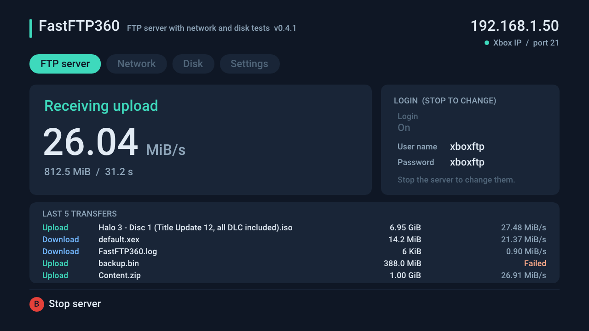
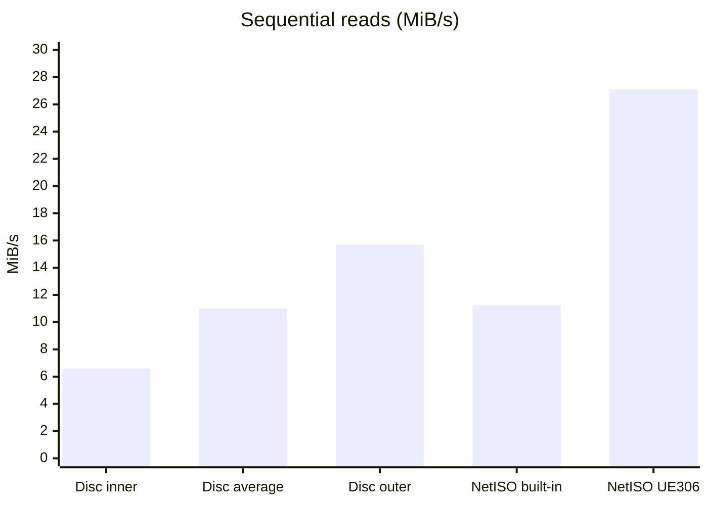
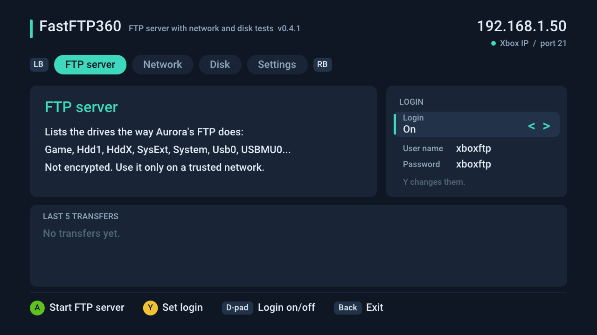
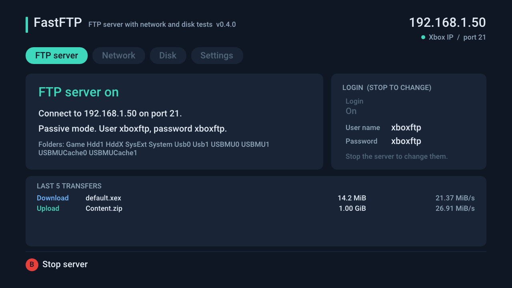
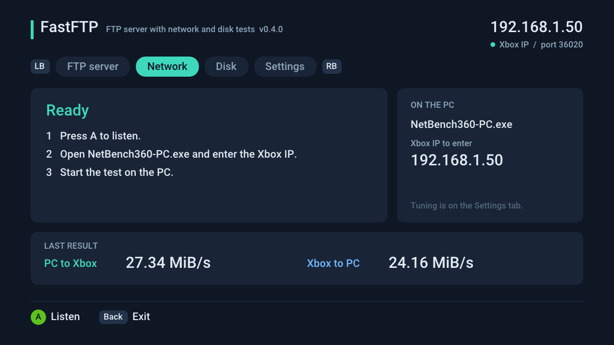
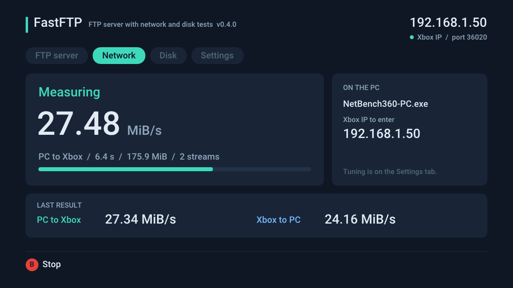
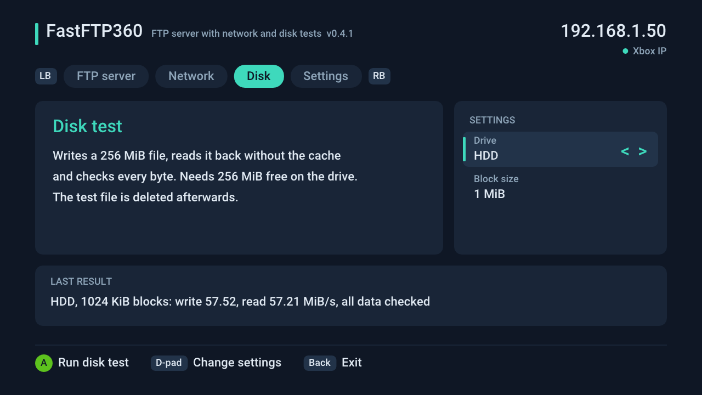
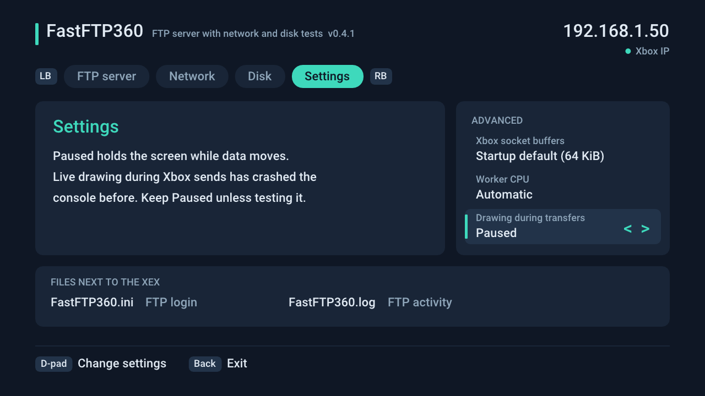
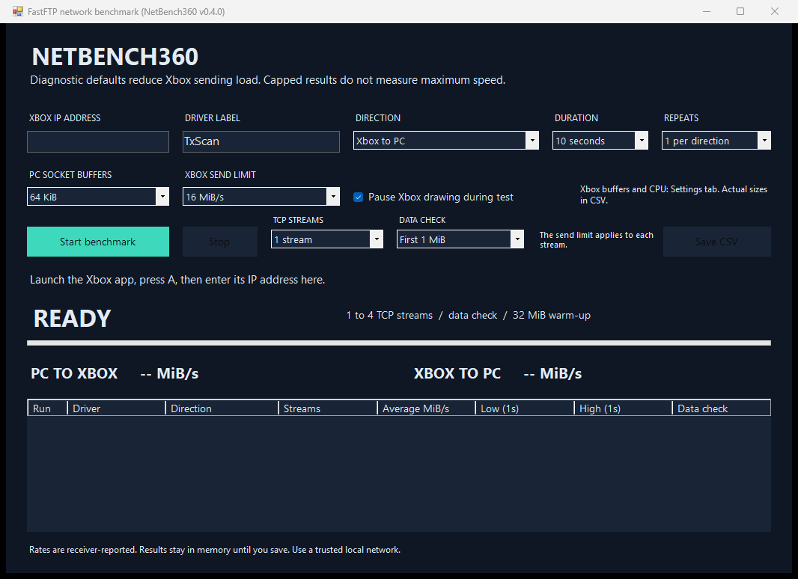
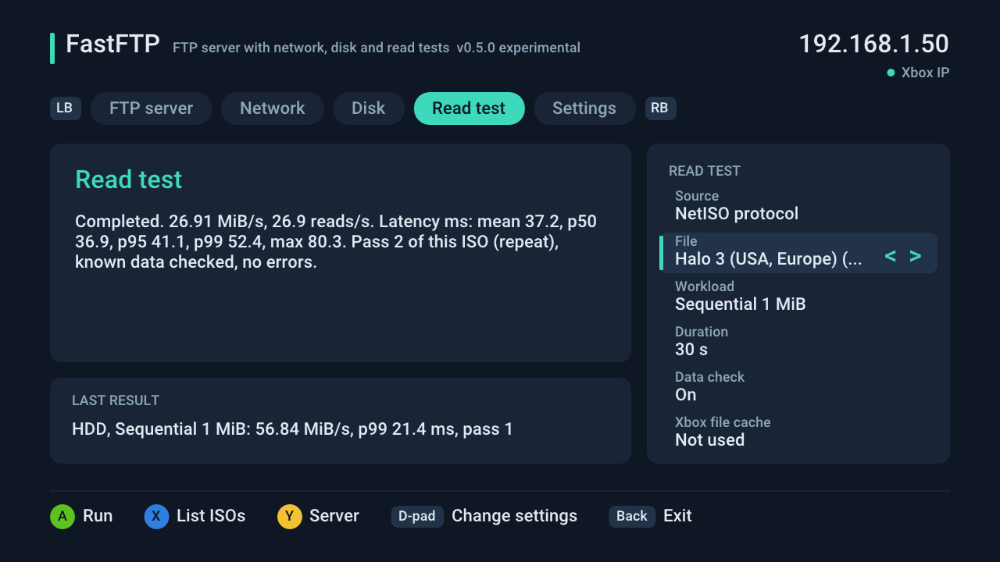

<p align="center">
  
</p>

<p align="center">
  <b>A fast FTP server for homebrew Xbox 360 consoles, with built-in network and disk tests.</b>
</p>

<p align="center">
  
</p>

FastFTP moves files between your PC and the Xbox's internal drive or USB storage using any regular FTP client, such as FileZilla. It reads and writes the disk **while** the network transfer is running, instead of one after the other. With a USB Ethernet adapter, uploads to the Xbox have reached about **27.5 MiB/s**, where Aurora's built-in FTP managed about 19.5 MiB/s on the same console.

- **Works like Aurora's FTP:** the same folder names (`Hdd1`, `Usb0`, `Game`...), so your paths and bookmarks keep working.
- **Your own login:** `xboxftp` / `xboxftp` by default. Change it with the Xbox keyboard or in `FastFTP.ini`.
- **Last 5 transfers** on screen with file name, size and speed. Everything is also written to `FastFTP.log`.
- **Network test and disk test** built in, to find out whether the network, the drive or the FTP client is the slow part.
- **Read test** (0.5.0, experimental): read throughput and latency from the internal drive, USB, a NetISO server or ConnectX, to see whether playing games from a LAN server is practical.

**Best with [CUsbEnet](https://github.com/marcusisdahl/CUsbEnet).** FastFTP was made alongside CUsbEnet 1.1, a USB Ethernet driver plugin for the Xbox 360. Together they're the fastest way we know of to copy files to an Xbox 360 over FTP. All the speeds on this page were measured with a TP-Link UE306 adapter on CUsbEnet. FastFTP also works over the console's built-in network port.

FastFTP is experimental homebrew. Read [Safety](#safety) before using it on files you care about.

## NetISO versus disc

Can you play games from a PC on your network instead of from disc? FastFTP's [Read test](#read-test) (0.5.0, experimental) measures that.

These are the first runs on one console. FastFTP read a game ISO with the NetISO protocol from a wired PC, 30 s per run, and all runs finished with 0 errors. The disc figures are published values, not measured here, because the test console's DVD drive is broken.

| Read | Game disc (12x DVD) | NetISO, built-in 100 Mbit port | NetISO, UE306 + CUsbEnet |
|---|---|---|---|
| Sequential 1 MiB | 6.6–15.7 MiB/s, about 11 on average | 11.23 MiB/s | **27.10 MiB/s** |
| Random 64 KiB | about 0.3–0.4 MiB/s (150–200 ms per read) | 10.41 MiB/s (6.0 ms) | **22.21 MiB/s (2.8 ms)** |
| Random 16 KiB | about 0.1 MiB/s | 8.91 MiB/s (1.8 ms) | **13.28 MiB/s (1.2 ms)** |
| Random 4 KiB | about 0.02 MiB/s | **6.77 MiB/s (0.58 ms)** | 5.80 MiB/s (0.67 ms) |



- **Large reads:** over the UE306, NetISO reads about 1.7 times faster than a disc at its best. The built-in port is about as fast as a disc on average.
- **Small scattered reads:** any network path is far faster than a disc, because there is no seek. At 4 KiB the built-in port is slightly ahead, because each request through USB costs about 0.3 ms more.
- **Game load times:** these will improve much less than the read speeds suggest, because a large part of loading is the console unpacking data. This is inferred from published disc-versus-install load times. Load times through the NetISO plugin have not been measured yet.

The full tables, sources and raw data are in [docs/READ-RESULTS.md](docs/READ-RESULTS.md).

## Contents

- [NetISO versus disc](#netiso-versus-disc)
- [Quick start](#quick-start)
- [The screens](#the-screens)
- [FTP server](#ftp-server)
- [Network test](#network-test)
- [Disk test](#disk-test)
- [Read test](#read-test)
- [Settings](#settings)
- [Why it is faster](#why-it-is-faster)
- [Safety](#safety)
- [Build from source](#build-from-source)
- [Project history](#project-history)

## Quick start

You need a console that runs homebrew (XEX) applications, a working network connection, and a PC on the same home network. If you use a USB Ethernet adapter, keep its driver loaded as usual. For the speeds shown here, use [CUsbEnet](https://github.com/marcusisdahl/CUsbEnet) 1.1.

1. Download `FastFTP-<version>.zip` from the [Releases page](https://github.com/marcusisdahl/Xbox360-FastFTP/releases).
2. Copy `FastFTP.xex` to its own folder on the Xbox, for example `Hdd1:\Apps\FastFTP\`.
3. Start it from Aurora, XeXMenu or your usual launcher. **Do not** add it to `launch.ini`: it is an app, not a plugin.
4. The app opens on the **FTP server** tab. Press **A** to start the server.
5. In your FTP client, connect with:

   | Setting | Value |
   |---|---|
   | Host | The IP address shown at the top right of the Xbox screen |
   | Port | `21` |
   | Protocol | Plain FTP (no TLS) |
   | Transfer mode | Passive |
   | User name / password | `xboxftp` / `xboxftp` |

6. When you are done, press **B** to stop the server, then **Back** to exit to the dashboard.

`FastFTP-PC.exe` in the zip is only for the network test. You don't need it for FTP.

## The screens

Switch tabs with **LB** and **RB** while nothing is running. The footer always shows the buttons that do something right now.

| | |
|---|---|
| <br>**FTP server**, ready. The right card shows the login to type into your FTP client. | <br>**FTP server** running, with the address, login and the folders it found. |
| <br>**Network** test, waiting for the PC app. | <br>**Network** test measuring PC to Xbox. |
| <br>**Disk** test with the drive and block size. | <br>**Settings** for the advanced options. |

These images are drawn by the same screen code the console runs (`tests/ui_preview.cpp`), with example values.

## FTP server

### Login

The default user name and password are both `xboxftp`. To choose your own, press **Y** on the FTP server tab while the server is stopped. The Xbox keyboard asks for the user name and then the password: 1 to 23 letters, digits or symbols, no spaces. Cancelling either one leaves the login unchanged.

On the FTP tab, **D-pad Left/Right** switches the login off, so any user name and password work. The login is saved in `FastFTP.ini` next to the XEX, which you can also edit on a PC:

```ini
login=on
user=xboxftp
password=xboxftp
```

Missing or invalid lines keep the defaults.

### Folders

The top level lists the drives the way Aurora's FTP does, sorted by name, so paths such as `/Hdd1/Content/...` are the same in both servers. Only drives that are present and readable are listed.

| FTP path | Contents |
|---|---|
| `/Game/` | The drive and folder FastFTP was started from |
| `/Hdd1/` | The internal hard drive |
| `/HddX/`, `/SysExt/`, `/System/` | Hard drive system partitions |
| `/Usb0/` to `/Usb2/` | USB storage devices |
| `/USBMU0/` to `/USBMU2/`, `/USBMUCache0/` to `/USBMUCache2/` | USB sticks formatted by the Xbox |

### Transfer list and log file

The FTP tab lists the last five finished transfers with their file name, size and speed, newest first. Every event is also written to `FastFTP.log` next to the XEX:

```text
2026-10-13 18:40:12  FTP server started on 192.168.1.50 port 21, login xboxftp. Folders: Game Hdd1 Usb0
2026-10-13 18:40:31  192.168.1.20  Logged in as xboxftp
2026-10-13 18:44:52  192.168.1.20  Upload /Hdd1/Games/game.iso, 7466336256 bytes in 259.10 s (27.48 MiB/s)
```

Wrong logins, downloads, deletes, renames, new folders and disconnects are logged too. When the log grows past 1 MiB, it is moved to `FastFTP.old.log` the next time the server starts.

### What the server supports

- Uploads, downloads, folder listings, file sizes, new folders, deleting, and renaming.
- Up to **four** client connections at once. One is usually enough. More connections don't add speed, because the connection itself is the limit.
- Control port **21**. Passive data ports **36100 to 36199**.
- **Not supported:** active mode (`PORT`/`EPRT`), FTPS/TLS, SFTP, and resuming a partial transfer. Restart an interrupted upload from the beginning.
- Uploading to an existing name replaces the file. A failed upload is deleted, so an interrupted overwrite does not keep the old file.
- Each finished transfer's `226` reply in the FTP client log shows bytes, seconds and MiB/s.

## Network test

The network test measures raw TCP speed between the PC and the Xbox's memory, with no disk involved. Use it to check what your network adapter and driver can do before blaming the disk or the FTP client.

1. On the **Network** tab, press **A**. The Xbox listens on port **36020**.
2. On the PC, run `FastFTP-PC.exe` and enter the Xbox IP.
3. Pick a direction, duration and number of streams, then start the test.

<p align="center"></p>

The PC app can run 1, 2 or 4 TCP streams, check every byte (**All data**), limit the Xbox's send rate, and save results to CSV. Each stream first checks 1 MiB of known data and warms up with 32 MiB, then runs the timed transfer. The receiver reports the final rate. Use the PC app from the same release as the XEX. Versions with a different protocol are rejected.

The Xbox send limit applies **per stream**. While data moves, the Xbox holds a still screen by default and the PC shows live progress. B still stops the test.

## Disk test

On the **Disk** tab, use the D-pad to pick the drive (app drive, HDD, USB 0 or USB 1) and the block size (64 KiB, 256 KiB or 1 MiB), then press **A**.

The test writes a **256 MiB** file named `FASTFTP-DISKTEST.TMP`, including the final flush. It then reads the file back without the cache, checks every byte, and deletes it. You need more than 256 MiB free. **B** cancels.

USB storage and a USB Ethernet adapter share the Xbox's USB bandwidth. So FTP to a USB drive is much slower than FTP to the internal drive, even though both disks are fast on their own.

## Read test

> **Experimental; ABadAvatar 1.3 / ABadUpdate compatibility not yet verified.** Version 0.5.0 has had its first NetISO protocol runs on a console, but the console checklist is not done. Keep your working FastFTP and test this one from its own folder.

<p align="center"></p>

The **Read test** tab reads an existing file and reports MiB/s, reads per second, and read latency (mean, median, p95, p99, maximum), plus failed, short and timed-out reads. It never writes.

| Source | What it reads |
|---|---|
| Internal HDD, USB 0, USB 1, App drive | A file in `FastFTP-Bench` on that drive |
| Game disc | One of the largest files on the disc in the DVD drive, to compare with NetISO |
| NetISO protocol | An ISO straight from a NetISO server on port 4323. FastFTP talks to the server itself, **bypassing the console's NetISO plugin**, so this is not a full gameplay-path test. |
| ConnectX | A file through the ConnectX module, only if it is **already loaded** and you set its folder in `FastFTP.ini` |

Pick the source, press **X** to list files (or **Y** first to set the NetISO server), choose the file, the workload (sequential 64 KiB / 256 KiB / 1 MiB or random 4 / 16 / 64 KiB) and the duration (30 s default), then press **A**. A 3-second warm-up is never measured. Files named `FFTPFIX-<seed>.*` are known-data fixtures, and every byte read from them is checked. Results go to `FastFTP.log` and `FastFTP-reads.csv` next to the XEX.

FastFTP never loads, unloads or configures NetISO or ConnectX. Reading through a mounted NetISO disc is not implemented, because the plugin's device name could not be verified. The reference server `netiso-srv` can cut 256 KiB and 1 MiB replies short; `tests/netiso_server.py` is a fixed test server.

The comparison with a game disc is near the top of this page: [NetISO versus disc](#netiso-versus-disc).

Details, recovery, and what each number means: [docs/READ-BENCHMARKS.md](docs/READ-BENCHMARKS.md). Before trusting it on your console: [docs/CONSOLE-TEST-CHECKLIST.md](docs/CONSOLE-TEST-CHECKLIST.md).

## Settings

The **Settings** tab holds options most people never need. While stopped, **D-pad Up/Down** picks one and **Left/Right** changes it. The left card explains the selected option.

| Setting | Choices | Used by |
|---|---|---|
| Xbox socket buffers | Startup default (64 KiB), 128 KiB, 256 KiB | FTP and network test. The Xbox may refuse bigger buffers, and bigger is not always faster. |
| Worker CPU | Automatic, hardware thread 0 to 5 | Network test streams |
| Drawing during transfers | Paused (default), Live | FTP and network test. Keep **Paused**: live drawing during Xbox sends has crashed the console in testing. |

## Why it is faster

A simple FTP server reads or writes a chunk of the file, then sends or receives it over the network, then repeats, so the disk and the network take turns waiting. FastFTP gives each transfer a helper thread and **two 1 MiB buffers**:

- **Upload:** the network fills one buffer while the helper writes the other to disk. The file is flushed before the transfer is reported as complete.
- **Download:** the helper reads ahead into one buffer while the network sends the other.

Network sends go out in 16 KiB pieces with a short yield in between, which keeps the console responsive during long transfers.

Measured on one console with a TP-Link UE306 USB Ethernet adapter and the [CUsbEnet](https://github.com/marcusisdahl/CUsbEnet) 1.1 acksmall driver:

| | PC to Xbox |
|---|---|
| Network test (RAM to RAM) | about 27.7 MiB/s |
| FastFTP upload to the internal drive | about 27.5 MiB/s |
| Aurora's built-in FTP | about 19.5 MiB/s |
| Internal drive on its own (disk test) | about 57 MiB/s |

At this point the Xbox's USB 2 controller is the limit, not the disk or the FTP server. Your numbers depend on the adapter, driver, drive, FTP client and network.

## Safety

- **Nothing is encrypted**, including the login. Use FastFTP only on a trusted home network, never port-forward it to the internet, and stop it with **B** when you are done.
- Anyone who logs in can overwrite and delete files on every listed drive, including the system partitions. Keep backups of anything important.
- FastFTP is an app you start yourself. It does not install itself, change `launch.ini`, patch the kernel, write NAND, or change your network driver. It writes only the files your FTP client sends, its own `FastFTP.ini`, `FastFTP.log` and `FastFTP-reads.csv`, and the disk test's temporary file. The read test only reads.
- Homebrew can still crash or hang the console. Keep a known-good driver and your usual recovery method.

The host tests run the same FTP server code on Windows with Python's `ftplib`. They cover file operations, exact byte counts, path handling, the login, `FastFTP.ini`, the log, and simultaneous sessions. They are not a substitute for testing on a console. See the [changelog](CHANGELOG.md) for what has and hasn't been tested on hardware, and the [crash investigation](docs/CRASH-INVESTIGATION.md) for an earlier console freeze during network tests.

## Build from source

You need Visual Studio 2022 C++ tools, an Xbox 360 SDK with the RXDK-360 Visual Studio integration (toolset `2010-01`), and .NET Framework 4.5 or later. The SDK is not included.

From PowerShell in the repository:

```powershell
.\build.ps1
```

This produces `build\xbox\FastFTP.xex` (the Xbox app) and `build\windows\FastFTP-PC.exe` (the network test's PC app). The `.exe` next to the XEX is an intermediate PowerPC file, not the PC app. You can also open `FastFTP.sln` and build **Release | Xbox 360**. The project uses `DEVKIT_ONLY=0` for retail consoles and never deploys to a console automatically.

To build the PC app and run the host tests without the Xbox SDK (needs Python 3):

```powershell
.\build.ps1 -HostOnly -Tests
```

`build\host\ui-preview.exe out.bmp <scene>` renders the Xbox screen without a console, and is how the images in this README are made. The network test's wire format is described in [docs/PROTOCOL.md](docs/PROTOCOL.md).

## Project history

FastFTP grew out of **NetBench360**, a network benchmark for testing USB Ethernet drivers on the Xbox 360. Its FTP server turned out to be faster than Aurora's, so it became its own project. Version 0.4.0 renamed the XEX, the PC app and the Visual Studio solution to FastFTP.

## License

MIT, see [LICENSE](LICENSE). Xbox 360 SDK components are not included and keep their own terms. This project is not affiliated with Microsoft.
