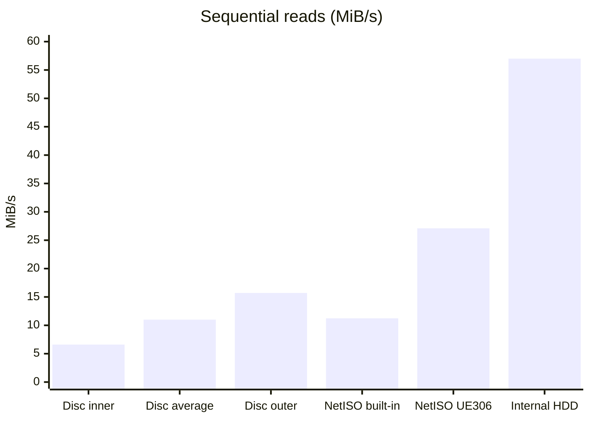

# Read test results

How fast can an Xbox 360 game read its data over the network, compared with a disc, the internal hard drive and a USB drive? This page collects the numbers measured so far with FastFTP's **Read test**, alongside published figures for the parts we could not measure. Each figure says where it comes from.

> **Experimental; ABadAvatar 1.3 / ABadUpdate compatibility not yet verified.** These results come from one console. They show that FastFTP 0.5.0's Read test ran and returned these numbers there. They are not a full pass of the [console checklist](CONSOLE-TEST-CHECKLIST.md).

- [Summary](#summary)
- [NetISO protocol: built-in Ethernet versus UE306](#netiso-protocol-built-in-ethernet-versus-ue306)
- [Game disc](#game-disc)
- [Internal HDD and external USB drive](#internal-hdd-and-external-usb-drive)
- [What this means for game loading](#what-this-means-for-game-loading)
- [Filling the gaps](#filling-the-gaps)
- [Sources](#sources)

## Summary

| Source | Sequential 1 MiB | Random 64 KiB | Random 16 KiB | Random 4 KiB | Basis |
|---|---|---|---|---|---|
| **NetISO protocol, UE306 + CUsbEnet** | 27.10 MiB/s | 22.21 MiB/s (2.8 ms) | 13.28 MiB/s (1.2 ms) | 5.80 MiB/s (0.67 ms) | Measured |
| **NetISO protocol, built-in 100 Mbit port** | 11.23 MiB/s | 10.41 MiB/s (6.0 ms) | 8.91 MiB/s (1.8 ms) | 6.77 MiB/s (0.58 ms) | Measured |
| **Game disc (12x DVD)** | 6.6 to 15.7 MiB/s, about 11 on average | about 0.3 to 0.4 MiB/s (150 to 200 ms) | about 0.1 MiB/s | about 0.02 MiB/s | Published figures; random reads estimated from seek time |
| **Internal HDD** | about 57 MiB/s | not measured | not measured | not measured | Measured, Disk tab |
| **External USB drive** | not measured | not measured | not measured | not measured | |

Figures in brackets are the time per read. MiB/s for random reads is reads per second × request size.

## NetISO protocol: built-in Ethernet versus UE306

**Setup, 2026-10-14:**

- **Software:** FastFTP 0.5.0 experimental, Read test, NetISO protocol source.
- **Server:** `tests/netiso_server.py` on a wired Windows PC.
- **File:** Guitar Hero III ISO.
- **Run settings:** 30 s per run after a 3 s warm-up, with Data check on. A game ISO is not a fixture, so only byte counts were checked.
- **Adapter:** a TP-Link UE306 (original ASIX AX88179) on CUsbEnet, or the console's built-in Ethernet port.
- **Errors:** all 12 runs finished with 0 errors.

The raw numbers are in [results/2026-10-14-netiso-ports.csv](results/2026-10-14-netiso-ports.csv).

| Workload | Built-in MiB/s | UE306 MiB/s | UE306 / built-in | Built-in ms per read | UE306 ms per read |
|---|---|---|---|---|---|
| Sequential 1 MiB | 11.23 | 27.10 | 2.41x | 89.1 | 36.9 |
| Sequential 256 KiB | 11.13 | 26.15 | 2.35x | 22.5 | 9.6 |
| Sequential 64 KiB | 10.74 | 23.40 | 2.18x | 5.8 | 2.7 |
| Random 64 KiB | 10.41 | 22.21 | 2.13x | 6.0 | 2.8 |
| Random 16 KiB | 8.91 | 13.28 | 1.49x | 1.8 | 1.2 |
| Random 4 KiB | 6.77 | 5.80 | 0.86x | 0.58 | 0.67 |

- **Both ports run at their link limit for large reads.** 11.2 MiB/s is what TCP can carry over 100 Mbit Ethernet. 27.1 MiB/s matches the 27.5 to 28 MiB/s ceiling that FTP and the Network test measured for the UE306 on the Xbox's USB 2 controller. Times per read were very steady: p99 was within a few percent of the median in every run.
- **The UE306 wins from 16 KiB upwards, and loses slightly at 4 KiB.** Working back from the 4 KiB numbers, each request seems to cost about 0.23 ms before any data moves on the built-in port, and about 0.53 ms on the UE306. That extra 0.3 ms per request through USB outweighs the UE306's bandwidth only for the smallest reads. This is inferred from the measurements, not measured directly.
- **The PC's cache was probably warm.** Most runs repeated reads of the same ISO, and the random workloads use a fixed seed, so later runs read offsets the PC had already cached. These numbers describe the network path, not the PC's disk.
- **The console's NetISO plugin was not involved.** FastFTP talks to the server itself, so the plugin's own overhead, caching and request sizes are not included.

## Game disc

The test console's DVD drive is broken, so the disc figures come from published sources. FastFTP 0.5.0 includes a **Game disc** source (read-only, lists the largest files on the disc) for anyone who wants to measure their own drive.

| Figure | Value | Source |
|---|---|---|
| Drive | 12x, constant angular velocity (CAV), 16.5 MB/s (15.7 MiB/s) maximum at the outer edge | Wikipedia |
| Inner edge | 2.4x slower than the outer edge, about 6.9 MB/s (6.6 MiB/s) | Wikipedia (the ratio); MB/s calculated |
| Average over a whole game | about 11 to 12 MB/s, estimated from hard drive install times | VGChartz forum |
| Seek and latency per file | about 150 to 200 ms. This is the figure for DVD drives in general; no measured number for the Xbox 360 drive was found. | Microsoft, *Optimizing DVD performance for games* |

Random-read rates in the summary are estimates: one seek of 150 to 200 ms plus the transfer time, per read.

## Internal HDD and external USB drive

- **Internal HDD:** the Disk tab on this console read its 256 MiB test file at about 57 MiB/s, which is about twice as fast as the UE306. Random reads have not been run on it yet.
- **External USB drive:** not measured with the Read test yet. On the Xbox, a USB drive shares the USB 2 controller with a USB Ethernet adapter. FTP uploads to a USB drive, which use the network and the drive at the same time, reached only about 8.5 MiB/s. A Read test on its own does not use the network, so it should do much better than that.

## What this means for game loading

This section is inferred from the numbers above. Load times themselves have not been measured.

- **For bulk reads**, NetISO over the UE306 is about 1.7 times faster than a disc at its best and about 2.4 times faster than a disc's average. The internal HDD is about twice as fast again. The built-in port is roughly as fast as a disc.
- **For scattered reads**, any network path is 50 to 250 times faster per read than a disc, because nothing has to seek.
- **Real load times will improve far less than those ratios.** Games are laid out on disc to avoid seeks. Published tests of games installed to the hard drive found them 0 to 16 s faster than from disc, on loads of 25 to 45 s, because much of loading is the console unpacking and setting up data. NetISO over the UE306 should therefore load roughly like a game installed to the hard drive: clearly better than disc on games that seek a lot, but not several times faster overall.

## Filling the gaps

1. Make a known-data fixture smaller than 4 GiB, so it fits on FATX and FAT32: `build\host\read-host.exe fixture C:\ISOs\FFTPFIX-0000002A.iso 4293918720 0x2A`.
2. Copy it to `Hdd1\FastFTP-Bench\` and `Usb0\FastFTP-Bench\` with FastFTP's FTP server, and put it in the NetISO server's ISO folder.
3. Run all six workloads, 30 s each, on **Internal HDD**, **USB 0** and **NetISO protocol**, with Data check on and the Xbox file cache bypassed. Each result should say *known data checked* with 0 errors.
4. Optionally, run the same game once from the HDD and once over NetISO through the console plugin, and time the loads with a stopwatch. That is the only test of the full game path.

Every run is added to `FastFTP-reads.csv` next to `FastFTP.xex`. Add the new rows to `docs/results/`.

## Sources

- [Wikipedia: Optical storage media writing and reading speed](https://en.wikipedia.org/wiki/Optical_storage_media_writing_and_reading_speed): the Xbox 360 drive's 12x speed and 16.5 MB/s maximum, and the 2.4x CAV ratio.
- [VGChartz forum: 360 DVD data limit](https://gamrconnect.vgchartz.com/thread/69437/360-dvd-data-limit-is-68-gb/32/): averages of 11 to 12 MB/s estimated from install times. These are forum estimates.
- [Microsoft: Optimizing DVD performance for Windows games](https://learn.microsoft.com/en-us/windows/desktop/DxTechArts/optimizing-dvd-performance-for-windows-games): DVD seek and latency of 150 to 200 ms.
- [GameSpot: Xbox 360 hard drive game installation testing](https://www.gamespot.com/articles/xbox-360-hard-drive-game-installation-testing/1100-6234271/) and [Engadget: DVD vs. hard drive load times](https://www.engadget.com/2008-10-31-xbox-360-load-time-comparison-dvd-vs-hard-drive.html): load times from disc versus from an install.
